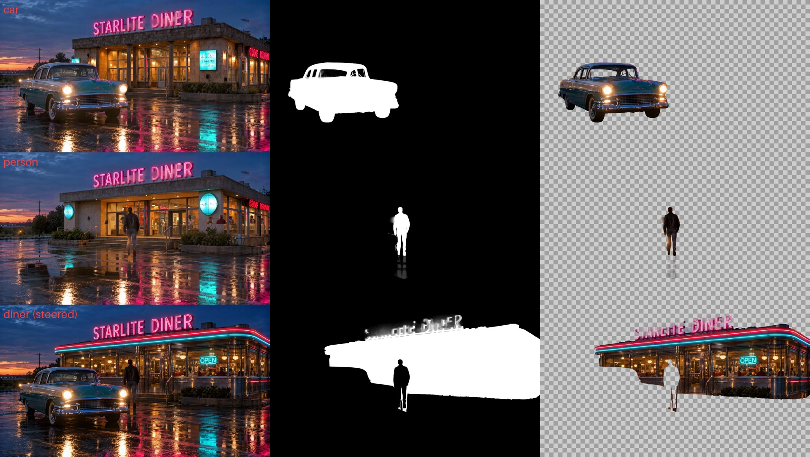

# AlphaGenSAM: AI mattes in Nuke, powered by ComfyUI

Part of the **DUGco OFX tool pack**.

> **Beta (v0.1.0, Windows).** Download the ready-to-install zip from
> [Releases](https://github.com/dughogan/nuke-alphagen-ofx/releases). Please report issues.

https://github.com/user-attachments/assets/82008daa-31d7-46d2-810f-cc1a0f74b993

**The demo** (86 s): selecting objects with SAM 3.1, pulling LTX-2.5 Alpha-Gen mattes on Comfy
Cloud, and the premulted layers in the Nuke viewer. Full-quality 1080p version:
[download](https://github.com/dughogan/nuke-alphagen-ofx/raw/main/docs/dugco_alphagensam_demo.mp4).

AlphaGenSAM is a Nuke node that pulls a clean, soft-edged matte for **one object** in a
busy shot: the car, the actor, the building. You type what you want (or Ctrl+click it),
press **Process**, and the matte lands in the alpha channel, with hair, glass and motion
blur intact.

Under the hood it runs **SAM 3.1** (selection and tracking), the **LTX clean-plate
IC-LoRA** (removes the other objects), **LTX-2.5 Alpha-Gen** (the matte) and **Depth
Anything 3** (who is in front). It never runs them in Nuke itself. Nuke is the whole
interface; **ComfyUI is the engine**, and you choose where that engine runs:

| | **Comfy Cloud** (default) | **Comfy Local** |
|---|---|---|
| What you need | A Comfy Cloud subscription and an API key | Your own ComfyUI and a big NVIDIA GPU (~48 GB VRAM) |
| Setup | 2 minutes: paste your API key into the node | Install ComfyUI and download ~40 GB of models |
| Where it runs | Cloud GPUs. Any laptop that runs Nuke will do. | Your machine, or another one on your network |

Same node, same results, either way. If your workstation isn't a GPU monster, **Comfy
Cloud gives you the compute while you keep working in Nuke.**

## Install (Windows)

1. Download **[DUGco_AlphaGenSAM_0.1.0_win64.zip](https://github.com/dughogan/nuke-alphagen-ofx/releases/download/v0.1.0/DUGco_AlphaGenSAM_0.1.0_win64.zip)**
   from [Releases](https://github.com/dughogan/nuke-alphagen-ofx/releases).
   Not the green **Code** button: that's the source code, without the built plug-in.
2. **Unzip it first** (right-click → *Extract All...*). Running `install.bat` from inside the
   zip doesn't work.
3. Close Nuke and double-click **`install.bat`** in the extracted folder.
   It copies the plug-in to `%LOCALAPPDATA%\DUGco\OFX` and tells Nuke where to find it
   (your user account only; no admin rights needed).
4. Start Nuke. The node is in the **DUGco** menu, or press Tab and type `AlphaGenSAM`.

To remove it, run `uninstall.bat`.

Cloned the repository instead? Run `install\install.bat`: it offers to download the latest
release and install that.

## Set up Comfy Cloud (the default)

1. **Subscribe to Comfy Cloud** at [comfy.org](https://www.comfy.org/cloud). Running jobs
   through the API needs a paid plan; free accounts are refused.
2. In Nuke, create an AlphaGenSAM node and open its **ComfyUI Backend** section.
3. Press **Get an API Key**. Your browser opens the
   [Comfy Developer Platform](https://platform.comfy.org). Sign in **with the same account
   that has your Cloud subscription** and create an API key.
4. Back in Nuke, press **Set API Key...**, paste the key (it stays hidden) and press Save.
   The node tells you straight away whether Comfy Cloud accepted it, and the **API key**
   line shows `saved (...abcd)`.

That's it. Every AlphaGenSAM node on this computer uses that key.

**Your key stays private.** It's saved in `Documents\DUGco\comfy_cloud_api_key.txt` on your
computer, never inside the Nuke script, so you can share `.nk` files safely. (Pipelines
can set the `COMFY_CLOUD_API_KEY` environment variable instead.)

Everything the node needs is already on Comfy Cloud: SAM 3.1, LTX-2.5, the Alpha-Gen and
clean-plate IC-LoRAs, and Depth Anything 3. There's nothing to download.

## Or use Comfy Local

1. Install [ComfyUI](https://www.comfy.org/download) 0.39 or later (core nodes only; no custom
   node packs needed) and start it.
2. Download these models into ComfyUI's model folders:

| Folder | File | Source |
|---|---|---|
| `checkpoints` | `sam3.1_multiplex_fp16.safetensors` | Comfy-Org repackage of Meta SAM 3.1 |
| `diffusion_models` | `ltx-2.5-22b-distilled-transformer-comfy-int8-convrot.safetensors` | `Lightricks/LTX-2.5` (gated: accept the license on Hugging Face) |
| `text_encoders` | `gemma4-12b-with-proj-ltx-2.5-comfy-int8-convrot.safetensors` | `Lightricks/LTX-2.5` |
| `vae` | `ltx-2.5-video-vae-bf16.safetensors`, `ltx-2.5-audio-vae-bf16.safetensors` | `Lightricks/LTX-2.5` |
| `latent_upscale_models` | `ltx-2.5-latent-spatial-upscaler-x2-bf16-1.0.safetensors` | `Lightricks/LTX-2.5` |
| `loras` | `ltx-2.5-22b-ic-lora-alpha-gen-0.9.safetensors` | `Lightricks/LTX-2.5-22b-IC-LoRA-Alpha-Gen` |
| `loras` | `ltx-2.5-22b-ic-lora-clean-plate-1.0.safetensors` (or the 2.3 version) | `Lightricks/LTX-2.5-22b-IC-LoRA-Clean-Plate` |
| `geometry_estimation` | `depth_anything_3_mono_large.safetensors` | Comfy-Org repackage of Depth Anything 3 |

3. In the node's **ComfyUI Backend** section, set **backend** to *Comfy Local*, check the
   **local server** address (default `http://127.0.0.1:8000`) and press **Test Connection**.

If a model is missing, the node names it when you press Process.

## Try the example

The `example` folder has a short neon-diner shot (`diner_plate.mp4`) and a ready-made Nuke
script, **`dugco_alphagensam_example.nk`**. Open it and press **Process** on each of the
three nodes:

* **AG_Car** (typed `car`), **AG_Diner** (typed `diner`) and **AG_Person** (a Ctrl+click on
  the walking man) each pull their own matte from the same plate.
* The alphas are copied into `car.a`, `person.a` and `diner.a` layers on one stream, with a
  cut-out preview of each over a checkerboard.
* They're set to frames 1-25 for a quick first run. Set `frame range` to *input range* for
  the whole shot.



## Use

**One node = one matte.** For several objects, branch several nodes off the same plate
(not one after another), then combine their alphas with Copy or Merge nodes.

1. **Select what you want a matte of.**
   * **Type it** in `select`: `car`, `diner`. SAM 3.1 finds every instance.
   * **Or click it:** Ctrl+click it in the viewer (Ctrl+Shift+click excludes, Alt+click
     deletes a dot). Clicking is best when there are several of the same thing, such as
     one person in a crowd.
   * If the object is lost later in the shot (it goes behind something and comes back),
     Ctrl+click it again on that frame. Up to 5 frames.
2. **Check the preview.** Every click or edit refreshes a coloured preview of the
   selection in a couple of seconds.
3. **Process.** It uses the input's frame range, or a custom range. Long shots are split
   into overlapping chunks and blended, so there's no limit on length. A progress bar
   shows the job; **Cancel** stops it.
4. **The matte is in the alpha channel.** `show` switches between the matte, a cut-out,
   the untouched plate (for comping) and the selection preview.

You never select what you *don't* want. Other people, cars and animals in the shot are
found and removed automatically. The list is in **Advanced > also remove**.

### How it pulls one object out of a busy shot

Alpha-Gen draws beautiful edges but mattes *everything* it thinks is foreground. So for
your object the node changes what Alpha-Gen sees:

1. **SAM 3.1** tracks your object and finds the other foreground things (**also remove**).
2. **Clean plate.** The LTX clean-plate IC-LoRA rebuilds what's behind those other
   things, only inside their area, so they disappear while your object and the rest of the
   plate stay pixel-for-pixel original.
3. **Alpha-Gen** mattes your object on that clean plate, so its edges are its own.
4. **Who's in front.** Where another object passes in front of yours, Depth Anything 3
   decides who's closer, and the hole is cut with the front object's own soft alpha (real
   hair edges, not a mask outline).
5. **Background objects** like buildings, which Alpha-Gen treats as background, use
   SAM's selection as the body plus whatever soft detail Alpha-Gen finds.

| Mode (Advanced) | What happens |
|---|---|
| clean plate (default) | The method above. |
| auto (paint out) | Faster: other objects are painted out with a fill instead of a clean plate. |
| fast (one pass) | One Alpha-Gen pass split between objects. Quickest, roughest. |
| alpha-gen only | Everything Alpha-Gen sees as foreground, no selection. |
| selection only | SAM 3.1's mask only. |

**Credit.** The isolate-then-matte idea builds on Rikin Patel's
[Comfy Pro Alpha Generator](https://github.com/rik-python/ComfyUI-Comfy-Pro-Alpha-Generator),
used with the author's permission.

### Notes

* **Colour.** Plates go to the models as sRGB (converted from linear by default). Change
  `input colour` under Advanced if your plate is already sRGB.
* **Resolution.** The models run at a working resolution (long edge 1920 by default,
  what Alpha-Gen is tuned for); the matte is resampled back to your plate.
* **Cache.** Each node keeps its downloaded mattes in a `dugco_cache` folder **next to your
  Nuke script**, so results travel with the shot and reopening the script never re-runs (or
  re-pays for) processing. Unsaved scripts use `%TEMP%\dugco\AlphaGenSAM` until you save.
  Change it with **cache folder** in the ComfyUI Backend section. The final matte is built
  from these layers when Nuke renders; put a Write node after AlphaGenSAM to deliver it.

## Build from source

You need the Visual Studio 2022 Build Tools (x64). Clone with the OpenFX headers
submodule:

```bat
git clone --recursive <this repo>
build.bat
tools\make_release.bat 0.1.0
```

`build.bat` builds `build\AlphaGenSAM.ofx.bundle` and `build\agsam_selftest.exe`, a headless
test of the whole backend round trip:

```bat
agsam_selftest <frames_dir> <count> <ref> <mode> <http://127.0.0.1:8000 | cloud> x,y,+ ... text:car ...
```

`make_release.bat` packs `dist\DUGco_AlphaGenSAM_<version>_win64.zip` with the bundle,
`install.bat`, `uninstall.bat` and this README.

The OpenFX headers come from `vendor/openfx`
([AcademySoftwareFoundation/openfx](https://github.com/AcademySoftwareFoundation/openfx), BSD-3-Clause).

| File | Role |
|---|---|
| `src/AlphaGenSAM.cpp` | OFX glue: parameters, viewer clicks, API key setup, render |
| `src/engine.*`, `src/passes.inc`, `src/layers.inc` | Graph builders, jobs, clean plate, depth order, matte maths |
| `src/comfy.*` | ComfyUI / Comfy Cloud REST client (WinHTTP) |
| `src/media.*` | PNG and H.264 with Windows' own codecs (WIC, Media Foundation) |
| `install/` | `install.bat`, `uninstall.bat` |

## Licenses

* **This plug-in:** MIT.
* **Models** carry their own licenses: LTX-2.5, Alpha-Gen and the clean-plate IC-LoRA use
  the LTX-2.x Community License; SAM 3.1 uses the SAM License; Depth Anything 3 its own.
  On Comfy Cloud they're provided by Comfy; locally, each artist downloads them under
  their own account.
